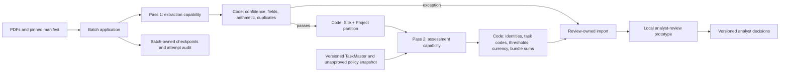

# Thursday CapEx demo: architecture-aligned presenter guide

## Status and the promise to make

**Demo date: Thursday, November 12, 2026.**

For the new existing-assets ADF flow, use the
[end-to-end presenter script](adf-end-to-end-demo-script.md). It includes
screen-by-screen narration, live-readiness gates and a clearly separated
historical fallback. The longer synthetic MVP sequence later in this guide
is a different exhibit, not proof of the new ADF path.

> The agent reads and reasons. Application code checks and calculates.
> The analyst decides.

This guide supersedes the earlier Friday presenter sequence for Thursday.
The successful Friday SQL execution remains unchanged and is the fallback.

The November 6 meeting transcript and supplied Thursday advice are the
provisional architecture specification. The v9.4 design attachment is
rights-protected and was not readable in this environment. No attempt was
made to decrypt it. The recording's visual content was not inspected; do
not claim its diagrams were verified. An authorized accessible export is
still needed for a line-by-line v9.4 conformance review.

### What is implemented versus demonstrated

| Surface | Actual status |
|---|---|
| Friday Azure SQL workflow | Previously succeeded: ten normalized invoice records, thirty lines, thirty task suggestions, thirty assessments, thirty per-line bundle decisions, zero groups. No changes to that execution or its stored results. |
| New opt-in MVP batch | Implemented and exercised locally against the existing Circle K Foundry model deployment. Reads PDFs, extracts, validates, partitions by Site + Project, assesses and evaluates bundles. It is not deployed to the existing Container Apps Job. |
| Stateless reasoning boundary | Local mode remains available. The approved repository increment adds an opt-in authenticated agent API and batch client for extraction/partition assessment. It accepts no SQL/review store. API code is locally tested, not deployed with an independent Azure identity yet. |
| Review App boundary | Working **local, loopback-only prototype**, with SQLite or existing SQL review-store selection, idempotent imports, original-source documents, analyst corrections/confirmations/defer actions and versioned audit. SQL-store behavior is locally tested through a DB-API harness, not a live SQL engine. Not a Power App, not authenticated and not production-ready. |
| Reference/policy evidence | Supplied versioned TaskMaster and unapproved policy snapshots, plus a locally tested read-only authenticated reference API. This serves pinned snapshots, not a full policy-document/knowledge retrieval platform. |
| Candidate asset | TaskMaster is the user's current demo asset/task reference catalog. Exact printed active task codes can be matched with an opt-in task-stage bypass. It contains categories, not physical site/asset identities. No existing asset ID or history is invented; a bundle ID is not an existing asset ID. |
| Managed review increment | Separate authenticated review-import/read/decision API and Azure SQL adapters are implemented and locally tested. The user reports applying migration 014 and its validator; application identity membership and live SQL integration remain unverified. The existing browser UI remains a local unauthenticated prototype; this increment does not add browser SSO. |
| ADF intake | On November 10 the user demonstrated successful Get Metadata discovery of the four selected source files through the managed-network runtime. The published `pl_capex_intake_check` contains Get Metadata only; it does not start processing. The source adapter and source-to-model worker below are locally tested, not deployed. Worker model responses have only been mocked; no new cloud/model execution is claimed. |
| Production integrations | No new Thursday processing job or authenticated APIs are deployed. POPA write-back, feedback learning and cross-run bundling remain excluded. Repository migration/API code and successful file discovery are not proof of an end-to-end cloud execution. |

### November 10 ADF source preparation

#### Platform-owner identity decision: UAMI is the target

On November 10 Ehsan confirmed that the agreed design uses a **user-assigned
managed identity (UAMI)** attached to ADF, with required access granted to that
identity. Reuse the selected `cict-ai-cus-capex-id`; do not introduce a new
identity or treat system-assigned authentication as the enduring design.
The worker already uses that UAMI.

Ehsan explicitly granted a temporary demo exception: `Container Apps Jobs
Operator` on `capex-task-determination-proof` to ADF's **current system
identity**, principal `c631d874-9b97-4a98-9eac-eaf011d211e5`. A subsequent
read-only Azure query confirmed that exact assignment. It is not a grant to
the UAMI and does not attach or select the UAMI on ADF.

The same inspection found:

- ADF is still `SystemAssigned` only, with no user-assigned identity attached.
- The factory's credential list is empty.
- `ls_capex_landing_blob` has no UAMI credential reference.
- No job-scoped/inherited assignment was returned for the selected UAMI
  (principal `cf7d7929-5beb-426b-bd19-493c5c0c506d`) on the proof job.

The current existing-assets pipeline template uses ADF system-identity MSI
for ARM calls. It is therefore **temporary-demo-exception wiring only**, not
the UAMI target architecture. Do not present or promote it as design closure.
Its separate deployment approval remains required.

UAMI alignment needs an approved change to attach the existing identity to
ADF, configure an ADF credential referencing it, explicitly select that
credential in the linked service and Web activities, and grant the UAMI the
necessary scoped job permission. Merely attaching an identity does not switch
existing authentication automatically. Follow
[Microsoft's ADF credential guidance](https://learn.microsoft.com/en-us/azure/data-factory/credentials).
An ADF credential is a child ARM resource, even though it is not a new
compute/storage service. Because none exists, flag its creation for approval
under the user's existing-assets constraint rather than silently adding it.
Do not delete the working system-identity grants or change networking before
the replacement is authorized and verified.

The user selected reuse of `cict-ai-cus-capex-id` for Thursday only. This is a
shared-identity demo compromise, not independent least-privilege service
identities. The separate ADF system identity has Blob Reader on `landing`;
its approved storage managed private endpoint and `ir-capex-managed-vnet`
were used in the successful intake debug run. The earlier linked-service
test reported a regional ADF hostname-resolution failure; the later actual
Get Metadata activity succeeded. Do not claim that connection-test error's
root cause was diagnosed.

The exact input folder is `cictaicusst/landing/capex/input`. Its four explicitly
selected sources are the Bruegmann and Kimley-Horn ABBYY ZIPs plus
`JC2000A07465-Ariba.xlsx` and `JC2000A07814 - Ariba+Proj.tool.xlsx`.
Do not treat every object in the container, or its `output` and `demo-v2`
folders, as a new invoice.

`python -m autarch.capex.demo_v2_intake` (also `capex-demo-v2-intake` after
installing the updated package) prepares these exact four filenames:

- Reads ZIP CSV exports using the existing ABBYY normalizer. This is
  **pre-extracted source normalization, not a fresh GPT PDF extraction**.
- Classifies both JC workbooks with the existing normalizer. Only approved
  `AI` invoice rows become packages; `JP` reversal/accrual and unapproved
  `OV` rows remain recorded in separate ledger-classification artifacts.
- Records original URIs, byte counts and SHA-256 values; checks archive sizes
  and member paths without extracting members into the filesystem. Remote
  downloads are size-checked and ETag-pinned.
- Produces one JSON artifact per invoice, both ledger classifications and a
  validated `DemoWorkflowRequest` under a unique run directory. The request
  pins the source hashes and policy version. It supplies **no synthetic
  context, no invented missing values, no currency conversion and no SQL
  persistence permission**.
- Publishes `intake.json` **last**, after the other artifacts were written.
  Failures propagate rather than publishing a ready marker. Output writes
  refuse overwrites; after a partial upload use a fresh run ID and inspect
  the failed run rather than silently reusing it.
- Performs **zero model calls and zero SQL writes**. `INPUTS_PREPARED` is
  not a task, accounting, bundling or review-completion result.

Local rehearsal, using the existing source files:

```powershell
$RunId = "adf-intake-" + (Get-Date -Format "yyyyMMddTHHmmss")
$OutputRoot = Join-Path $env:TEMP "capex-adf-intake"
.\.venv314\Scripts\python.exe -m autarch.capex.demo_v2_intake `
  --input-base-uri ".\examples\data\capex" `
  --output-base-uri $OutputRoot `
  --workflow-run-id $RunId `
  --policy-version "circle-k-na-demo-unapproved-2026-10-30"
```

The four local sources were verified to produce **10 packages, 30 lines,
7 excluded ledger records and 10 packages requiring review**. These counts
are not proof that the uploaded Blob bytes match the local files: compare
the recorded hashes during the actual cloud intake. Do not present them as
new model decisions.

For an approved VM/job runtime, the equivalent input base is
`https://cictaicusst.blob.core.windows.net/landing/capex/input` and the output
base can be a dedicated run prefix in
`https://cictaicusst.blob.core.windows.net/processed`. Set `AZURE_CLIENT_ID`
to the shared CapEx identity's client ID for managed-identity execution.
Do not paste tokens, account keys or SAS credentials into command arguments.

Remaining deployment work: build the worker image with pinned reference
snapshots in the existing registry, then reuse the existing proof job and let
ADF start and monitor its overridden execution using
the ADF run ID for correlation. Assign the ADF identity job-operator access
on the existing proof job only. Verify application completion and persisted outputs,
not merely a successful ARM start request. Keep the existing Friday SQL job
unchanged. No schedule is needed for the controlled demo.

### Source-to-model worker: implemented, not deployed

`python -m autarch.capex.demo_v2_adf_job` (also `capex-demo-v2-adf` after
installing the updated package) connects intake to the existing audited
task-suggestion, accounting and cross-invoice bundling workflow. It requires
`--execute` to opt in to billable calls, plus SHA-256-pinned TaskMaster and
policy snapshots. Reference drift stops execution before source preparation
or model calls. The current policy remains an **unapproved demo assumption**.

The current four-source local test covers **all 10 packages and 30 lines**,
but does not pretend that all of them have suitable reference data:

- Bruegmann and Kimley-Horn: 2 USD packages, 22 lines, eligible for the
  three model stages with the supplied US TaskMaster and North American
  USD policy. Missing source facts can still require Review.
- JC workbooks: 8 EUR/DKK packages, 8 lines, explicitly routed to Review
  in `reference-exceptions.json`. Their normalized packages, original hashes,
  line identities, ledger classifications and normalization review reasons
  are preserved. No model calls, USD accounting threshold, FX conversion
  or cross-currency bundles are applied to these packages. Governed regional
  task mappings and native-currency policies remain needed for full JC
  recommendations; the worker does not invent them.
- Mock-only verification records 5 calls: 2 task, 2 accounting, 1 bundling.
  This verifies the worker's request/output contracts, **not real GPT quality
  or a successful Azure run**. All mock recommendations require Review and
  propose no bundle groups; this is not the saved positive-control result.

Use the shared runtime identity only in the approved Azure job/VM, with
`AZURE_OPENAI_ENDPOINT` and `AZURE_CLIENT_ID` configured as above. An eventual
job command has this shape; replace both hashes with the SHA-256 of the
actual approved-for-demo reference bytes, and use a fresh run ID:

```powershell
python -m autarch.capex.demo_v2_adf_job `
  --input-base-uri "https://cictaicusst.blob.core.windows.net/landing/capex/input" `
  --output-base-uri "https://cictaicusst.blob.core.windows.net/processed/capex/adf-runs" `
  --workflow-run-id "<fresh-correlated-run-id>" `
  --task-master-uri "<accessible-pinned-task-master-json>" `
  --task-master-sha256 "<replace-with-64-lowercase-hex-characters>" `
  --policy-uri "<accessible-pinned-policy-json>" `
  --policy-sha256 "<replace-with-64-lowercase-hex-characters>" `
  --execute
```

This command is not evidence that the references have already been uploaded
or that the private job can access them. It requires the existing Azure
OpenAI endpoint `https://cict-ai-cus-foundry.cognitiveservices.azure.com/`
and uses deployment `gpt-5.1`.

The worker saves the full intake request and a separate `model-request.json`
for the eligible subset, explicit reference exceptions, audited
`llm-evidence.json`, and `result.json`. The result contains the **model subset**,
not the JC review exceptions. `batch.json` links the artifacts and reports
full input counts separately from model-stage and exception counts; it is
written **last**. A technical/model-validation/upload failure propagates
without publishing this completion marker. Existing output is not overwritten;
inspect a failed run and retry with a fresh ID. Business Review is a valid
outcome, not a technical success substitute.

Without the explicit SQL/extraction flags, persistence here is
**immutable JSON, zero SQL writes and zero ERP writes**.
It does not populate migration 014 tables or automatically import into the
PDF MVP review app. Existing-job image packaging and ADF update deployment,
job-scoped operator permission, real private-network model execution, live
SQL/review verification and the final presenter rehearsal remain separate work. Friday's
existing job and SQL results are unchanged.

#### Opt-in original PDF extraction and SQL review handoff

The worker now accepts `--fresh-pdf-extraction` and `--sql-persist`. The
existing-assets ADF template supplies both flags. This path is locally tested
with mock model responses; it has **not** been built or executed in Azure or
verified against the live SQL engine.

- Fresh extraction renders the original PDF member from each pinned ZIP,
  records extraction response/validation evidence, and replaces ABBYY-derived
  facts only when validation passes. JC workbooks retain workbook normalization.
  Actual extracted line counts can differ from the thirty preprocessed lines.
- SQL mode checks effective read/insert/update permissions before inference,
  loads `pub.v1_TaskMaster` and rejects semantic/source drift from the pinned
  catalog. Derived search-text formatting and task ordering are not catalog
  drift; source metadata and all governed task fields must still match.
  It requires `CAPEX_SQL_SERVER`,
  `CAPEX_SQL_DATABASE`, `AZURE_CLIENT_ID`, ODBC Driver 18 and existing table
  permissions. Review-role membership or equivalent direct table grants can
  supply the required review access; effective permissions are authoritative.
- Unsupported regional/currency references and failed extraction validation
  produce explicit non-model Review tasks and assessments for every affected
  line. Their assessment bundling disposition is Review. They do **not** create
  rows in the GPT-only `capex.BundleDecision` table, whose existing constraint
  requires `UsedLlm=1`; do not present those exceptions as model decisions.
- Task/assessment persistence, eligible model bundle decisions/evidence, and
  the `mvp_review` handoff share one caller-owned transaction and count readback.
  SQL failure retains failure evidence and prevents publication of `batch.json`.
  The marker reports `sqlPersistence` counts and `reviewStatus=AWAITING_ANALYST`.
  `sqlWrites` sums the reported result/handoff row counts, not every SQL statement
  or internal run/evidence row.
- Original-source review imports retain pinned PDF members and workbook bytes.
  Local import/replay, transaction rollback, SQL-store HTTP document reads and
  analyst defer are tested using a DB-API harness. This is not a live SQL Server
  integration test. The browser remains a loopback prototype, not a deployed
  analyst application.
  Zero ERP writes and no automatic business approval remain hard boundaries.

While platform authorization is pending, check the intended review VM without
changing permissions, installing packages or writing SQL:

```powershell
python --version
python -c "import pyodbc; import autarch.capex.demo_v2_review; print('ODBC drivers:', pyodbc.drivers())"
Test-NetConnection 'cict-ai-cus-sql.database.windows.net' -Port 1433 -InformationLevel Quiet
```

Run the import check from the extracted source directory using the Python
environment intended for review. It must report ODBC Driver 18 for SQL Server.
A successful TCP check proves reachability, not SQL authorization. These checks
do not prove that the VM has an assigned, SQL-authorized managed identity.
Do not assume the container job's identity is also assigned to the VM.
If imports or the driver are missing, resolve that specific prerequisite before
rehearsal; do not silently substitute SQLite for the SQL-backed demo.

If the import check fails because Python packages are missing (for example
`langchain_core`), install the declared extras into an isolated environment
from the extracted source directory, rather than adding packages piecemeal to
the VM's global Python:

```powershell
python -m venv .venv-review
if ($LASTEXITCODE -ne 0) { throw 'Review environment creation failed.' }
.\.venv-review\Scripts\python.exe -m pip install -e ".[capex,capex-demo]"
if ($LASTEXITCODE -ne 0) { throw 'Review dependency installation failed.' }
.\.venv-review\Scripts\python.exe -m pip check
if ($LASTEXITCODE -ne 0) { throw 'Review dependency verification failed.' }
.\.venv-review\Scripts\python.exe -c "import pyodbc; import autarch.capex.demo_v2_review; print(pyodbc.drivers())"
if ($LASTEXITCODE -ne 0) { throw 'Review import check failed.' }
.\.venv-review\Scripts\python.exe -m autarch.capex.demo_v2_review --help
```

Use that environment's Python for the review commands below. Installing
`pyodbc` does not install the native ODBC Driver 18; its presence must still
be verified in the printed driver list. Dependency installation does not
grant the VM a managed identity or SQL permissions.

For an existing private VM without a managed identity, local review can instead
explicitly use the signed-in Azure CLI account:

```powershell
az account set --subscription 0451df15-250e-42f5-b15c-f19a9bb9c21a
$env:CAPEX_SQL_SERVER = 'cict-ai-cus-sql.database.windows.net'
$env:CAPEX_SQL_DATABASE = 'cict-ai-cus-sqldb'
.\.venv-review\Scripts\python.exe -m autarch.capex.demo_v2_review --store azure-sql --sql-auth azure-cli serve --workflow-run-id '<completed-ADF-RunId>' --port 8765
```

Use an existing authorized CLI sign-in; if sign-in is required, use the normal
approved `az login` flow. The CLI account must already have SQL SELECT on
`mvp_review.imports`, `documents` and `decisions`, and INSERT on `decisions`
to record an analyst action. Grants to the worker do not grant the user access.
The token remains in memory and is never printed. This explicitly selected mode
ignores `AZURE_CLIENT_ID`, uses no managed identity and does not fall back to
one on failure. Other worker commands still default to managed identity.
This changes backend SQL authentication only: the loopback browser remains
unauthenticated, not SSO. A new review-auth patch is needed on extracted VM
sources that predate `--sql-auth`; no worker-image rebuild is required for
this local-only mode.

On existing private compute that **already** has SQL connectivity and an
authorized managed identity assigned, open the persisted run directly:

```powershell
$env:CAPEX_SQL_SERVER = 'cict-ai-cus-sql.database.windows.net'
$env:CAPEX_SQL_DATABASE = 'cict-ai-cus-sqldb'
# Set AZURE_CLIENT_ID only to an identity already assigned to this compute.
python -m autarch.capex.demo_v2_review --store azure-sql serve `
  --workflow-run-id '<completed-ADF-RunId>' --port 8765
```

Open `http://127.0.0.1:8765` on that host. Each HTTP request opens its own SQL
connection; source bytes and analyst audit stay in the existing `mvp_review`
tables. No SQLite copy/import is needed. This is not browser SSO and must not be
exposed on a network. If the private host lacks the assigned identity or SQL
permissions, stop and resolve approved access; do not open public networking or
create a new host to bypass this requirement.

The existing authenticated review API can read/decide already imported ADF
results and serves non-PDF source bytes as downloads. Its upload endpoint
remains the stricter MVP PDF-import contract; the ADF worker imports directly
inside its SQL transaction, not through that endpoint.

Only a successful execution plus `batch.json` confirms committed handoff.
`review.json` uploaded before SQL commit is candidate evidence, not proof of
SQL success; its nested result persistence counts are also candidate counts
until the marker confirms SQL readback. After the approved live run, set the ADF RunId in
[`validate_capex_adf_demo_run.sql`](../../sql/validation/validate_capex_adf_demo_run.sql)
and execute it through the authorized private SQL connection. No new tables
are required; this verification script is read-only and has not been run live.

### Existing-assets-only deployment scaffold

The user explicitly required **no new Azure resources**. The earlier proposed
new job, pipeline and JSON dataset were removed before deployment. The
repository now contains:

- `Dockerfile.capex-adf`: builds a worker image, bundles only the two pinned
  reference JSON files, checks CLI help and runs as a non-root user.
- `tools/Build-Push-CapexAdfAcr.ps1`: uploads an allowlisted build context to
  the **existing** registry, excludes invoice files, credentials, local
  environments and onboarding/session data, records hashes and returns the
  exact image digest. It does not change networking, scale build pools or
  deploy anything. A private pool must already be running; otherwise it stops.
- `infra/data-factory/capex-existing-demo.bicep`: updates **only**
  `pl_capex_intake_check` and `ds_capex_landing_files` in the existing factory.
  It does not deploy the factory, a job, linked service, runtime, endpoint,
  role assignment, SQL object or supporting Azure service.

The existing `capex-task-determination-proof` job already has the shared
identity, registry access, a 1-vCPU/2-GiB replica, zero retries and a
**900-second timeout**. ADF supplies the worker image, command, arguments and
environment as a **single-execution override**. The saved proof-job image and
configuration, preparation/dispatch jobs and Friday SQL job remain unchanged.
Rehearsal must verify the model run fits the existing 15-minute timeout;
do not silently extend the job or hide a timeout.

**Intentional ADF behavior change:** the existing intake-only pipeline becomes
the processing workflow. Its first activity still discovers files. Its new
`processInvoices` Boolean defaults to `false`; unless explicitly set to
`true`, it stops after discovery with `CAPEX_PROCESSING_NOT_ENABLED`. This is
an explicit safety stop, not successful processing. Debugging just the Get
Metadata activity still provides the intake check. No schedule/trigger is added.

When enabled, it verifies the four exact filenames are files, starts the
existing proof job without retrying the non-idempotent start, follows ARM's
asynchronous start response and polls **that returned execution**. An absent
execution identity, failed status read, unsuccessful execution or missing
completion marker fails the pipeline. It never substitutes the latest execution.

The existing Binary dataset gains `folderPath` and `fileName` parameters,
defaulting to `capex/input` and blank filename. ADF reuses it to check
`landing/capex/output/adf-runs/{ADF-RunId}/batch.json` after job success.
**ADF checks existence, not JSON contents.** The worker validates the model
contract and writes the marker last, before returning success. Inspect its
actual JSON/evidence during rehearsal. No new JSON dataset or additional
storage permission is needed.

#### Ehsan: confirmed temporary demo assignment on an existing job

ADF's system identity is distinct from the shared worker identity. The
existing Blob Reader assignment on `landing` does not permit ARM job
start/status operations. Ehsan has now assigned the **existing built-in**
`Container Apps Jobs Operator` role at the **existing proof-job scope only**,
using the command below. It is confirmed read-only; do not ask him to repeat
the completed assignment. This is his temporary demo exception, not the
agreed UAMI target described above. It creates no custom role and gives
the presenter no role-assignment authority. The built-in role also includes
job stop/logstream/exec actions; it is not a custom start-only role.

```powershell
az role assignment create `
  --subscription '0451df15-250e-42f5-b15c-f19a9bb9c21a' `
  --assignee-object-id 'c631d874-9b97-4a98-9eac-eaf011d211e5' `
  --assignee-principal-type ServicePrincipal `
  --role 'Container Apps Jobs Operator' `
  --scope '/subscriptions/0451df15-250e-42f5-b15c-f19a9bb9c21a/resourceGroups/cict-aisandbox-cus-rg/providers/Microsoft.App/jobs/capex-task-determination-proof'
```

#### Approved deployment procedure, not yet executed

Deployment still requires separate approval. Before applying the template,
GET the exact existing pipeline and dataset and retain their original
definitions in the ignored active session for rollback. Review ARM what-if:
**only these two existing ADF assets may be modified; reject application
resource Create/Delete changes**. Do not deploy into a different scope or
recreate a missing asset.

After approval, build with `tools/Build-Push-CapexAdfAcr.ps1`. Read its
`image-reference.json` and pass `imageSha256`, `taskMasterSha256` and
`policySha256` to the existing-assets template. This is a new image artifact
inside an existing registry, not a new registry/job. Use the existing RG:

```powershell
$Image = Get-Content -Raw '<actual-build-evidence>\image-reference.json' | ConvertFrom-Json
az deployment group what-if `
  --subscription '0451df15-250e-42f5-b15c-f19a9bb9c21a' `
  --resource-group 'cict-aisandbox-cus-rg' `
  --template-file '.\infra\data-factory\capex-existing-demo.bicep' `
  --parameters imageSha256=$Image.imageSha256 `
    taskMasterSha256=$Image.taskMasterSha256 policySha256=$Image.policySha256
```

Only after reviewing the diff, use `az deployment group create` with those
same arguments. Verify the saved proof-job configuration and Friday job are
unchanged. Confirm Ehsan's grant, then run `pl_capex_intake_check` manually
with `processInvoices=true`. Match the ADF RunId to the job arguments,
completion-marker path and model evidence. Record actual Blob hashes,
counts, eligible model results, JC Review exceptions and runtime duration.
Uploading source code, compiling Bicep, a green job-start HTTP response or
a unit test is not a completed cloud rehearsal.

### Actual saved rehearsal results

These are real GPT-5.1 calls, not mocked model responses:

1. **Synthetic positive control**
   - Run: `thursday-mvp-provisional-bundle-20261109T181000Z`.
   - Two explicitly synthetic one-page invoices, four charge lines.
   - Two different synthetic vendors and POs, same synthetic Site + Project.
   - Seven recorded model calls: two extraction, two task, two accounting,
     one bundling call.
   - One standalone CapEx recommendation and one routine-repair OpEx
     recommendation.
   - Two capitalizable-by-nature components are individually below the
     USD 1,000 demo unit threshold, so their individual recommendations are
     OpEx. The model separately proposes that they form **one provisional
     USD 1,200 bundle**, with two members at USD 600 each.
   - Group: `bundle-d426040aa9da5945763344e3`.
   - This proposal does **not** rewrite the individual accounting outputs,
     approve capitalization or post anything to POPA.
2. **Real-PDF exception path**
   - Run: `thursday-mvp-real-v2-20261109T181500Z`.
   - Original Bruegmann and Kimley-Horn PDFs were read by the model.
   - Two extraction calls; both documents correctly entered the
     implemented review route rather than being enriched with invented
     source facts.
   - The saved extraction contains eleven Bruegmann charge lines and ten
     Kimley-Horn charge lines. The earlier normalization has twelve
     Bruegmann lines, including its shipping representation. These are
     different extraction representations, not a verified equality check.
   - Missing/ambiguous dates, header-adjustment evidence, Kimley-Horn
     currency and quantity/unit-cost fields are visible review reasons.
   - Do not claim extraction accuracy or completeness has been established.

An earlier model request returned HTTP 500. The failure was recorded; a
controlled resume succeeded. Use the saved final runs during the talk.
The saved results are demonstrations, not a finance-reviewed gold-label
benchmark. Confidence is model-reported, not measured correctness.

## Changes that matter to the architecture



“Two passes” describes two logical capabilities, not two model calls.
The current assessment capability retains separate task, accounting and
bundling subcalls for reuse of the tested contracts.

The primary partition is **Site + Project**. PO, vendor, task code and
currency do not split that initial partition. Task and currency still
constrain whether a particular bundle is valid. Only current-run lines
are considered.

In the opt-in MVP only, a fully evidenced, resolved-task, below-threshold,
capitalizable line may remain accounting Review because policy requires
analyst confirmation and still be evaluated for a **provisional** bundle.
Missing required facts, unresolved tasks, repairs and exclusions remain
ineligible. The model must establish the asset relationship; code does
not manufacture a group. Accounting Review is never silently converted
to approval. The existing Friday mode retains its original stricter gate.

### Why Friday is still useful

Friday proves persisted, traceable model recommendations on the staged
ten-invoice dataset. Thursday adds the architectural boundaries that
Friday did not demonstrate: fresh extraction, explicit validation
exceptions, primary Site + Project partitions and an actual analyst UI.

Do not present the new local run as execution
`capex-demo-v2-sql-qfr1i2b`, or claim its outputs are in Azure SQL. That
execution belongs to Friday's saved v4 workflow:
`friday-sql-gpt-contract-v4-20261105T150000Z`.

## Operator setup before rehearsing

### Option A: use the already-saved results (recommended for the presentation)

The prepared local review database is self-contained: it contains the
original PDF bytes, imported recommendations and analyst audit. It does not
need Azure credentials or model calls just to show an imported run.

Use the supplied review database handoff, set `$ReviewDb` to its downloaded
path, and start from the repository root in an environment with the
existing CapEx dependencies:

```powershell
python -m pip install -e ".[capex,capex-demo]"
$ReviewDb = "C:\Demo\thursday-mvp-review.sqlite"
python -m autarch.capex.demo_v2_review --db $ReviewDb serve `
  --workflow-run-id thursday-mvp-provisional-bundle-20261109T181000Z `
  --port 8765
```

Open **http://127.0.0.1:8765/** on the same machine as the process.
Keep that terminal open. Stop it with Ctrl+C afterward.
The server binds to loopback only. Do not publish it, change its binding,
or expose it as a production service. An approved VM can run the same UI
inside that VM's browser.

Use the imported-run links at the top to switch between the synthetic
positive example and real-source exception example.

The audit includes a clearly labeled synthetic UI-verification action, if
present in the handoff. That is not a business approval. Choose a fresh
unmodified document for a live correction, or show the existing audit.
Never delete history to stage a clean screen.

Export the imported results plus recorded analyst decisions after practice:

```powershell
python -m autarch.capex.demo_v2_review --db $ReviewDb export `
  --workflow-run-id thursday-mvp-provisional-bundle-20261109T181000Z `
  --output "C:\Demo\thursday-practice-audit.json"
```

The output must be a new file.

### Option B: create a fresh run before the meeting

Do this during preparation, **not while the audience waits**. These
commands incur model calls when `run` is invoked.

```powershell
python -m pip install -e ".[capex,capex-demo]"
$DemoRoot = Join-Path $env:LOCALAPPDATA ("CapexThursday-" + (Get-Date -Format "yyyyMMddTHHmmss"))
New-Item -ItemType Directory -Path $DemoRoot
$RunId = "thursday-synthetic-" + (Get-Date).ToUniversalTime().ToString("yyyyMMddTHHmmssZ")
$env:AZURE_OPENAI_ENDPOINT = "https://cict-ai-cus-foundry.cognitiveservices.azure.com"

python -m autarch.capex.demo_v2_mvp prepare `
  --source-root ".\examples\data\capex" `
  --workflow-run-id $RunId `
  --synthetic-case `
  --fixture-directory (Join-Path $DemoRoot "synthetic-pdfs") `
  --output-uri (Join-Path $DemoRoot "manifest.json")

python -m autarch.capex.demo_v2_mvp run `
  --manifest-uri (Join-Path $DemoRoot "manifest.json") `
  --state-db (Join-Path $DemoRoot "batch.sqlite") `
  --output-uri (Join-Path $DemoRoot "result.json") `
  --allow-synthetic-inputs
```

Omit `--synthetic-case` and `--fixture-directory` to prepare the original
Bruegmann/Kimley-Horn PDFs instead. This real-source path is expected to
show missing-input exceptions; it must not fabricate a happy path.
The JC workbooks and Friday's staged SQL snapshot remain in the existing
demo, not this PDF-only MVP intake.

After a completed run:

```powershell
python -m autarch.capex.demo_v2_review --db (Join-Path $DemoRoot "review.sqlite") import `
  --result-uri (Join-Path $DemoRoot "result.json")

python -m autarch.capex.demo_v2_review --db (Join-Path $DemoRoot "review.sqlite") serve `
  --workflow-run-id $RunId --port 8765
```

Exit codes: **0** means the batch completed without extraction exceptions;
**2** means it completed with extraction exceptions routed for review;
**1** means an execution failure. A successful batch can still contain
accounting Review recommendations and requires analyst review.

To recover from a failed batch, keep the exact original manifest and source
bytes and add `--resume` to the same `run` command. Successful extraction
and complete partition checkpoints are reused. Failed partitions are
recomputed; no claim is made of exactly-once billing for an interrupted
model request. Do not edit the manifest and call it the same run.
Successful outputs are not overwritten.

The manifest pins extraction/accounting/bundling prompt versions, source
hashes, TaskMaster and policy snapshots. Batch attempt history records
failed attempts as well as accepted model responses. Token usage and dollar
cost are not available in this implementation; do not quote them.

### Azure authentication

The Circle K CLI context was verified on November 9:

- Subscription: `0451df15-250e-42f5-b15c-f19a9bb9c21a`
- Tenant: `19da1f3c-d958-44ea-850d-195c1502525c`
- Existing model resource: `cict-ai-cus-foundry`
- Deployment: `gpt-5.1`, model version `2025-11-13`

CLI authentication is separate from the Azure extension account picker.
The extension was still on a Contoso context during preparation.
PIM role activation does not switch accounts or grant every data-plane
permission automatically.

If the CLI session expires, the operator signs in manually to the tenant,
selects the subscription and completes MFA/PIM as required. Do not change
firewalls or grant broader roles to make the rehearsal work.

### Dependencies and lockfile caveat

The new optional `capex-demo` extra supplies PDF rendering and image support.
The original SQL runtime does not need it. Use the pip command above on the
existing supported demo environment (Python 3.12 or the verified 3.14
environment), rather than changing the project's global Python floor.

`uv lock` could not resolve the existing CapEx extra for the repository's
declared Python 3.9 floor: the already-required Agent Framework package needs
Python 3.10+. Public-index access also failed; the configured package proxy
was reachable and revealed that dependency-floor conflict. The existing
lockfile was left unchanged rather than altering unrelated support policy.
The new extra was installed and exercised successfully with pip.

## The 30-minute presentation

### Pre-open these screens

1. **Local review UI:** synthetic positive run selected, original PDF visible.
2. **Local review UI:** second tab with the real-PDF exception run selected.
3. **Azure Portal:** `cict-aisandbox-cus-rg`, then:
   - `cictaicusst` / container `landing`;
   - Container Apps Job `capex-demo-v2-sql` / execution history /
     `capex-demo-v2-sql-qfr1i2b`;
   - `cict-ai-cus-foundry` / deployed model `gpt-5.1`;
   - registry `cictaicusacr` / repository `capex/demo-v2`.
4. **Existing private SQL connection:** Friday's saved source and output
   views, filtered to its exact workflow ID.
5. **Editor:** this guide's architecture diagram and the saved MVP result.

Do not spend the demo signing in, searching Storage folders, rebuilding a
container, running schema migrations or diagnosing connectivity.

### 00:00-03:00 | Set boundaries and start with documents

**Where:** local review UI, synthetic positive run, source PDF pane.

**Show:** the large synthetic banner, printed synthetic invoice/vendor,
four source lines across two PDFs, printed task codes, two POs and shared
assembly notes.

**Say:**

> Today I am demonstrating the core processing boundaries from Friday's
> architecture discussion. The batch owns orchestration and state; the
> agent reads and reasons; application code validates; and the analyst
> makes the decision.
>
> I will first use a completely synthetic positive-control case to make
> the entire sequence visible. Every invoice, vendor, PO, site and project
> in this case is synthetic. The USD 1,000 threshold and processing
> assumptions are unapproved demo inputs. The task catalog comes from
> the supplied US TaskMaster.
>
> I will then show extraction exceptions on the real PDFs and the
> previously verified Azure SQL results. The review interface you see
> here is a local prototype, not a deployed Power App.

**Explain:** the synthetic source explicitly prints task 5225 to avoid
arbitrarily choosing between indistinguishable task-catalog entries. This
is a controlled validation case, not evidence that real-source task
ambiguity has been solved.

### 03:00-06:00 | Establish ownership and Azure tools

**Where:** architecture diagram, then Portal job and Foundry tabs.

**Show:** the main path, existing job's successful execution, existing model.

**Say:**

> This is a batch-led application, not an agent-led transaction system.
> The batch receives a manifest, calls extraction, validates its response,
> groups by Site and Project, requests assessment and bundling, validates
> those responses and hands the results to review-owned storage.
>
> In this implementation, the agent capability is called in-process
> and has no transactional database connection. The batch owns the
> checkpoints. The review application owns the analyst decisions.
>
> Container Apps Jobs and the versioned registry image are proven in
> Friday's SQL run. The new two-pass path was exercised locally using
> this existing Foundry deployment; it has not replaced that cloud job.

**Explain tool roles:**

- Blob Storage: source and saved workflow artifacts.
- SQL: Friday's staged records and persisted recommendations.
- Container Apps Job: Friday's batch execution.
- ACR: its versioned image.
- Foundry model: actual inference used by both paths.
- Local batch database: new rehearsal checkpoints/attempt audit.
- Separate local review database: imported PDFs, recommendations and
  analyst decisions.

Do not call the local SQLite store an Azure SQL database, a new ODS or an
authenticated enterprise Review App.

### 06:00-10:00 | Pass 1: extraction and deterministic checks

**Where:** local synthetic run; expand the extraction fields.

**Show:** invoice header, quantities, costs, amounts, confidence, page
references and quoted source text. Compare them with the PDF.

**Say:**

> The first capability reads the invoice page images and returns
> structured JSON. It proposes the values and includes page references.
> The batch then checks required fields, confidence, duplicates,
> quantity times unit cost, subtotal and header adjustments.
>
> These arithmetic checks are code, not an LLM's opinion. A passing
> structural check does not prove that the extraction is correct, so
> the source remains visible for review.

**Show:** the empty extraction exception list on the positive case.

**Switch:** real-PDF exception tab; show one actual missing-field reason.

**Say:**

> Here the model could not establish all the required facts from the
> real document. We retain the missing values and stop assessment of
> that document. We do not invent a date, currency, quantity or unit
> price to make the demo pass.

Do not label missing source facts as model hallucinations unless the PDF
comparison establishes that. The actual extraction completeness has not
been benchmarked against finance labels.

### 10:00-13:00 | Site + Project grouping

**Where:** return to the synthetic positive run; saved result's `partitions`
or recommendation detail.

**Show:** `DEMO-SITE-POSITIVE`, `DEMO-PROJECT-POSITIVE`, invoices A and B,
different vendors/POs and their shared `WS-DEMO-1` assembly identity.

**Say:**

> After extraction checks, the batch groups work by Site and Project.
> PO is not the partition key. That lets the assessment capability
> consider related costs across purchase orders and suppliers.
>
> This partition is the reasoning work package. It does not mean every
> invoice in it becomes one asset. Task compatibility, currency and
> source-supported asset relationships are still checked before a
> bundle can be proposed.

Site/project identities here are labeled demo context; they were not
verified against a production project master.

### 13:00-17:00 | Pass 2: task and accounting recommendations

**Where:** task/accounting summary table, then rationale details.

**Show these three contrasts:**

1. **Task:** task 5225 from the explicitly printed synthetic source and
   supplied catalog.
2. **Repair:** `SYNTHETIC-DEMO-A:line-2`, routine repair, OpEx by nature.
3. **Standalone asset:** `SYNTHETIC-DEMO-B:line-2`, USD 1,500, CapEx
   recommendation under the supplied demo unit threshold.

**Say:**

> In the second logical pass, the capability recommends the task and
> accounting treatment using the source facts and versioned references.
> The current implementation uses several model calls inside that pass;
> two passes does not mean only two model requests.
>
> This repair is OpEx because it is routine repair by nature. This new
> complete shelving unit is capitalizable by nature and its individual
> unit cost meets the demo threshold.
>
> Code checks valid task identities, required evidence references,
> currency, thresholds and internally consistent recommendations.
> These are still recommendations for human review, not approved
> accounting or ERP postings.

**Explain:** the agent does not retrieve real existing assets in this
prototype. Point to the explicit “no asset register supplied” disclosure.
Policy IDs link the answer to the supplied snapshot, not to an independently
verified full IFRS interpretation.

### 17:00-21:00 | Cross-invoice provisional bundling

**Where:** provisional bundle table and rationale details.

**Show:** group `bundle-d426040aa9da5945763344e3`, two members, USD 600 +
USD 600 = **USD 1,200**.

**Say:**

> These two lines are on different synthetic invoices and POs but refer
> to the same explicitly documented new shelving assembly. The frame
> and decks are not independently usable.
>
> Individually, both are below the unit threshold. Separately, the model
> proposes that they represent one asset. Code checks membership,
> task, Site, Project, currency and the exact sum. It does not decide
> the physical relationship or manufacture a bundle.
>
> This is a provisional single-asset proposal. It has not changed the
> individual recommendations, and it has not approved capitalization.
> An analyst must assess that proposed treatment.

**Explain:** the repair is excluded; the separate USD 1,500 complete asset
is not pulled into this group merely because its task is also shelving.

**Important distinction:**

> Friday's real-source run proposed zero groups. This separate synthetic
> control proves the positive proposal path, not a newly discovered
> bundle in the real invoices.

### 21:00-25:00 | Analyst correction, decision and audit

**Where:** analyst form below the recommendation.

**Do one safe live action:**

1. Enter a label such as `Synthetic rehearsal analyst` (not a real
   authenticated identity).
2. Enter a reason explicitly saying this is a demonstration.
3. Choose correction field `invoiceNumber`.
4. Enter a synthetic corrected value, such as
   `SYNTHETIC-DEMO-A-REVIEWED`.
5. Click **Save correction / needs reprocessing**.
6. Point to the saved version, timestamp and hash-linked audit.

**Say:**

> The analyst can compare the PDF with the extraction and the
> recommendation, then record a correction or disposition. The
> original model output is preserved. A correction does not silently
> rewrite the original invoice or recompute its accounting result.
>
> This action is recorded in review-owned storage and marks the item
> as needing reprocessing. The batch's inference history is separate.
> The MVP does not use this correction for future inference.

**If showing confirmation instead:** choose a document with no unresolved
extraction or accounting Review, enter a demo reason, explicitly check the
**simulated manual POPA completion** box and click Confirm. The result is
`CONFIRMED_DEMO_ONLY`, not a business approval.

Never say that the checkbox updated or actually verified POPA. It is a
simulation. Corrected inputs cannot later be confirmed without a new
processing run.

### 25:00-28:00 | Show the verified SQL evidence and fallback

**Where:** existing private SQL results, then the Portal job.

**Show:** Friday's source `prep.Invoice`, `prep.InvoiceLine` and
`prep.InvoicePackage`, then output/audit rows filtered to
`friday-sql-gpt-contract-v4-20261105T150000Z`.

**Say:**

> This is the stable cloud execution we already verified: ten staged
> invoice records and thirty lines from Bruegmann, Kimley-Horn and
> the JC workbooks. SQL holds thirty task suggestions, thirty linked
> accounting assessments and thirty bundling decisions.
>
> The audit records twenty-two model requests and responses. Seven
> lines received CapEx recommendations, two OpEx and twenty-one Review.
> No positive bundle group was proposed. This is coverage and
> traceability evidence, not an accuracy percentage.

**Show:** `task.TaskSuggestion`, `capex.Assessment`,
`capex.BundleDecision` and `capex.LlmShowcaseRun`.
Use existing result views; do not create or run a new workflow query.

The Azure Portal SQL resource Overview does not itself display table rows.
Use the approved private SQL session already proven to work.

Optional Storage evidence:
`cictaicusst` -> `landing` -> `capex` -> `demo-v2` -> `sql`.
The v4 snapshot, result and evidence JSON files are saved workflow
artifacts, not the original invoices.

### 28:00-30:00 | Close with what is proven and what is next

**Where:** architecture diagram and summary.

**Say:**

> We have shown extraction, explicit code checks, Site and Project
> grouping, task and accounting recommendations, a source-supported
> provisional bundle, an analyst correction and a stored audit trail.
>
> The new path was exercised locally against the existing Foundry
> model. Friday's cloud SQL run remains preserved. The next steps
> are an authorized design conformance review, business validation
> against expected outcomes, approved regional policies and mappings,
> and deployment of the review and import boundaries with enterprise
> authentication and durable managed storage.
>
> Automated ingestion, feedback learning, cross-run bundling and
> dashboards are later increments. POPA remains manual.

Do not quote model accuracy, production readiness, token cost, or
analyst-effort savings without measurements that establish them.

## Five-minute fallback if time or connectivity fails

1. Open the saved synthetic review run: show source, task, repair OpEx,
   standalone CapEx and the provisional USD 1,200 group.
2. Show one real-PDF extraction exception.
3. Show the recorded analyst correction and audit version.
4. Show Friday's already-opened successful Portal execution and SQL audit.
5. Close with the ownership sentence and prototype/production boundary.

The saved local UI does not need model calls or an Azure token to display
its imported data. Do not introduce a live model call to rescue a demo.

## Rehearsal checklist

- [ ] Use the final provisional-bundle run, not the earlier zero-group
      synthetic rehearsals.
- [ ] Say “synthetic positive control” before showing its invoices.
- [ ] Keep original real-source and synthetic outputs clearly separated.
- [ ] Original PDFs render in the approved browser; use “Open original
      invoice PDF” if the embedded viewer is unavailable.
- [ ] Rehearse one correction; verify it survives refreshing the page.
- [ ] Never label a local analyst label as authenticated identity.
- [ ] Use Friday's exact workflow ID in SQL; do not mix earlier baseline
      bundle results into it.
- [ ] Explain Site + Project partition versus task/currency compatibility.
- [ ] Explain individual below-threshold treatment versus provisional
      bundle treatment.
- [ ] State the design-document/production gaps without presenting them
      as implemented.
- [ ] Keep the main walkthrough under thirty minutes.

## Repository service increment and private VM handoff

The user approved repository changes on November 9, confirmed an available VM
and DBA, and designated TaskMaster as the current demo asset reference.
This does not turn TaskMaster categories into a physical asset inventory.
Cost-estimate discussion is deferred at the user's request; it is not permission
to provision resources, broaden access or replace Friday's job.

### Implemented surfaces

- `autarch/capex/demo_v2_api.py` hosts exactly one of `agent`, `reference`, or
  `review` per process. The agent/reference hosts cannot receive a review store.
- `autarch/capex/demo_v2_remote.py` supplies HTTPS-only, bearer-authenticated
  batch/operator clients. Redirects and automatic model-call retries are disabled.
- `--taskmaster-bypass` is an opt-in **prepare** flag pinned into a new manifest.
  Fully evidenced, printed, active TaskMaster codes can bypass the task model
  for an entire invoice. Ambiguous/missing codes still use the model; an explicitly
  invalid code or extraction exception routes to Review. Accounting and bundling
  still use the model and existing code validators. There is no keyword-based
  automatic accounting approval.
- Each new document's `referenceRouting` records the rule version, snapshot hash,
  exact matches, category fields and null `existingAssetId`. Evidence records
  actual task-stage bypasses and model attempts; confidence is not accuracy.
- `--state-store azure-sql` selects `mvp_batch` checkpoints. Local SQLite remains
  the default. Review runtime uses `mvp_review`; review documents are embedded,
  hashed PDF bytes, not URLs fetched by the review service.
- The legacy `sqlWrites: 0` result flag means no native Friday recommendation-table
  writes. New `batchStateStore` explicitly reports whether checkpoint state uses
  Azure SQL. Review API imports/decisions themselves write the separate review
  store; do not describe the managed path as making no database writes.

### DBA handoff

1. Review [014_create_thursday_mvp_stores.sql](../../sql/migrations/014_create_thursday_mvp_stores.sql).
   It creates six tables and two least-privilege roles in the existing database.
   It does not alter Friday's schemas or TaskMaster, or execute model calls.
2. After approval, the DBA applies it in `cict-ai-cus-sqldb`.
3. For the preferred separated topology, the DBA creates the approved distinct
   Entra users and adds only batch to `capex_mvp_batch_runtime`, only review to
   `capex_mvp_review_runtime`; agent and reference receive no SQL role.
   The November 10 Thursday-only override reuses `cict-ai-cus-capex-id`: if the
   new SQL-backed batch/review path is deployed, its existing or newly created
   database user needs both runtime-role memberships. Do not recreate an
   existing database user or alter its Friday memberships. This shared access
   is explicitly not independent least privilege and remains unverified until
   checked against the actual database.
4. Run [014_validate_thursday_mvp_stores.sql](../../sql/tests/014_validate_thursday_mvp_stores.sql).
   This is read-only. Save its results for rehearsal.
5. Test ODBC connectivity and concurrent import/decision behavior against the
   actual SQL engine. Local DB-API harness tests are not SQL Server integration.

### Entra and service configuration for the administrator

Use the Circle K tenant `19da1f3c-d958-44ea-850d-195c1502525c`. Each API needs an
approved application registration/audience. Configure v2 access tokens
(`requestedAccessTokenVersion: 2`); the host validates RS256 signatures through
the tenant's fixed JWKS endpoint, issuer, audience, tenant, time claims and
object ID. It never trusts a caller-supplied actor or proxy identity header.

| API | Required app roles | Intended caller |
|---|---|---|
| Agent | `Capex.Agent.Invoke` | Batch identity |
| Reference | `Capex.Reference.Read` | Batch identity / approved operator |
| Review import | `Capex.Review.Import` | Batch identity only |
| Review read | `Capex.Review.Read` | Approved analysts/operators |
| Review decision | `Capex.Review.Decide` | Approved analysts/operators |

Assign roles explicitly, not just consent or subscription PIM. User/operator
tokens must contain the appropriate assigned roles too. For the Azure CLI
operator client, the administrator must expose/consent an appropriate delegated
scope (for example `access_as_user`) for the approved client; a user role assignment
alone does not guarantee CLI token acquisition. Do not disable validation if
consent/token acquisition fails.

Required host environment: `CAPEX_TENANT_ID`, `CAPEX_API_AUDIENCE` (API application
client-ID GUID), and the host's own `AZURE_CLIENT_ID`. Agent also needs
`AZURE_OPENAI_ENDPOINT` and a pinned manifest URI. Review needs `CAPEX_SQL_SERVER`
and `CAPEX_SQL_DATABASE`. Reference needs only a pinned manifest URI.
The host sets `AZURE_CLIENT_ID` to its **own** user-assigned managed identity;
API audience and managed-identity client ID are different settings.

### VM/operator commands after separate deployment approval

The new services are **not deployed yet**. Replace placeholder origins and
application IDs only after deployment; never enable public ingress to make the
private VM rehearsal easier. The VM needs approved private DNS/network access,
ODBC Driver 18 for SQL operations and the relevant assigned identity/roles.

Install the opt-in extras into the VM's approved Python environment:

```powershell
python -m pip install -e ".[capex,capex-demo,capex-cloud]"
python -m autarch.capex.demo_v2_api --help
python -m autarch.capex.demo_v2_remote --help
```

Server entry points (one identity/process/container per service, TLS terminated
by the approved private ingress; do not expose uvicorn's HTTP port directly):

```powershell
python -m autarch.capex.demo_v2_api --service agent --manifest-uri "<pinned-manifest-uri>" --port 8000
python -m autarch.capex.demo_v2_api --service reference --manifest-uri "<pinned-manifest-uri>" --port 8000
python -m autarch.capex.demo_v2_api --service review --port 8000
```

Agent/reference manifests must use the same TaskMaster, policy snapshots, model
deployment and bypass setting as batch. The agent reconstructs normalized
packages and revalidates extraction, uniqueness and the single Site/Project
partition; caller-provided prompts are not accepted.

New batch invocation after deployment (the existing local invocation is unchanged):

```powershell
python -m autarch.capex.demo_v2_mvp run `
  --manifest-uri "<new-pinned-manifest-uri>" --state-store azure-sql `
  --output-uri "<fresh-result-uri>" --allow-synthetic-inputs `
  --agent-url "https://<private-agent-origin>" --agent-audience "api://<agent-app-id>" `
  --reference-url "https://<private-reference-origin>" --reference-audience "api://<reference-app-id>" `
  --review-url "https://<private-review-origin>" --review-audience "api://<review-app-id>"
```

The batch uses its own managed identity for API tokens and SQL access. Reference
drift fails before model processing. Import embeds the source PDFs, checks their
SHA-256 and is immutable/idempotent by run ID and result hash. Stale analyst
versions and conflicting imports return HTTP 409, not false success.
If import fails after a result is saved, do not overwrite or rerun that result:

```powershell
$env:CAPEX_TENANT_ID = "19da1f3c-d958-44ea-850d-195c1502525c"
python -m autarch.capex.demo_v2_remote --url "https://<private-review-origin>" `
  --audience "api://<review-app-id>" --credential azure-cli import --result-uri "<saved-result-uri>"
python -m autarch.capex.demo_v2_remote --url "https://<private-review-origin>" `
  --audience "api://<review-app-id>" --credential azure-cli read `
  --run-id "<run-id>" --output-uri "<fresh-audit-uri>"
```

To demonstrate a decision, the operator client also supports `decide --run-id
"<run-id>" --request-uri "<decision-json-uri>"`. Example request:

```json
{"documentId":"SYNTHETIC-DEMO-A","expectedVersion":0,"action":"DEFER","reason":"Demo: finance review required"}
```

Do not supply `actor`: the server derives tenant/object ID from the validated
token and persists it in the hash-linked decision. Confirmation remains
`CONFIRMED_DEMO_ONLY`, requires explicit simulated manual POPA completion, and
refuses unresolved/corrected items. No actual POPA posting occurs.

### Verification and Thursday presentation boundary

Local tests exercise signed JWT rejection, roles, isolation, remote batch
contracts, reference drift, import replay/conflict, authenticated decision
identity, reopening persisted audit, raw PDFs, and store adapters. The test
signing key is local test-only; this is not proof of live Entra consent or role
assignments. A real uvicorn/socket check also exercises authenticated HTTP.

A fresh actual GPT run, `thursday-taskmaster-bypass-20261109T191500Z`, made four
calls. Invoice A passed and bypassed its task call. Invoice B omitted required
page references for its four extracted document notes, so code routed it to
Review and did not assess it. The run is `REVIEW_REQUIRED`, with zero groups:
do not hide this outcome or call it a new positive bundle. The earlier saved
seven-call provisional-bundle run remains the positive control. All original
outputs and audits are retained unchanged.

The earlier multi-service API proposal is not the current ADF slice and does
not authorize new Azure services. Before claiming that separate increment is
live, verify the user-applied schema/runtime memberships, actual Entra tokens
and negative-role cases, private VM access, restart persistence and operator
workflow. Any hosting plan must respect the user's existing-resources-only
constraint and receive its own approval. The current ADF scaffold neither
deploys those APIs nor integrates their SQL/review stores.
Production readiness, browser SSO, feedback learning, physical asset-history
matching, cross-run bundling and the full knowledge platform remain out of scope.

## Engineering verification recorded on November 9

The approved repository service increment subsequently passed **175 focused
tests** and a clean Pyright check across all six affected runtime modules.
This includes real-socket HTTP startup/shutdown, signed test-token rejection,
failed remote-call evidence retention and persistence/replay contract checks.
The exact saved positive, real-source exception and new bypass result artifacts
all validate against the import API contract. No live Entra app registration,
Azure SQL engine, container-image build or deployed-endpoint test is claimed.
The existing global lockfile caveat still applies; this increment does not
silently raise the repository's Python floor.

Earlier local MVP verification (before the service increment):

- 148 focused regression tests passed across the new MVP and the existing
  SQL workflow, task suggestion, batch runner, handoff, image build and
  authentication tests.
- All three changed runtime modules passed Pyright with zero errors and
  zero warnings using the verified demo interpreter.
- Original PDFs and generated synthetic PDFs rendered successfully.
- Real GPT requests produced the saved extraction exceptions and the
  provisional positive bundle described above.
- The actual saved-model review run accepted a demo-only correction and
  demo-only confirmation through HTTP. Both persisted across a reload;
  the exported audit and both database integrity checks were verified.
- Automated HTTP tests cover source-PDF access, stale decisions, invalid
  review tokens and cross-origin rejection.
- The integrated browser initially loaded the prototype, but lost its
  local connection after a server restart. A complete visual/browser
  walkthrough remains a presenter rehearsal item, not a claimed test pass.
- The temporary verification server was stopped. Launch the review command
  above when ready to practice.
